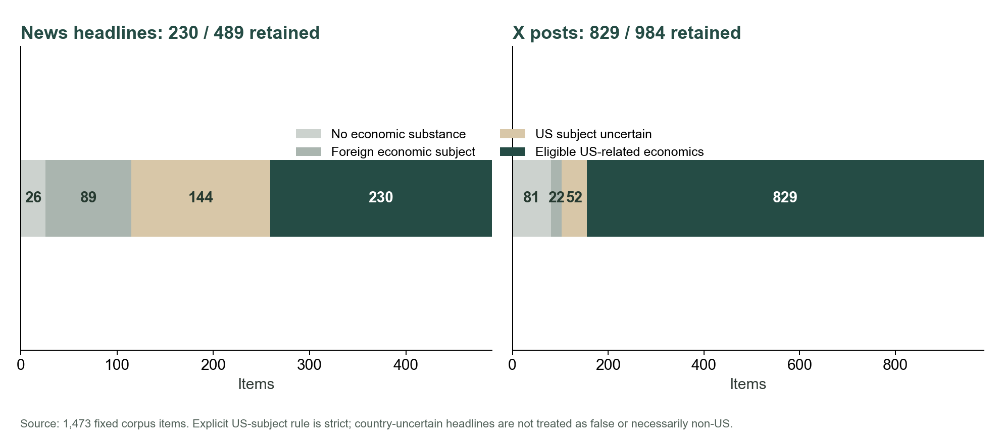
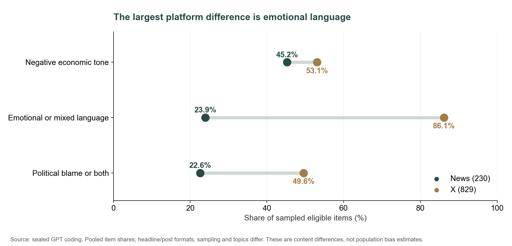
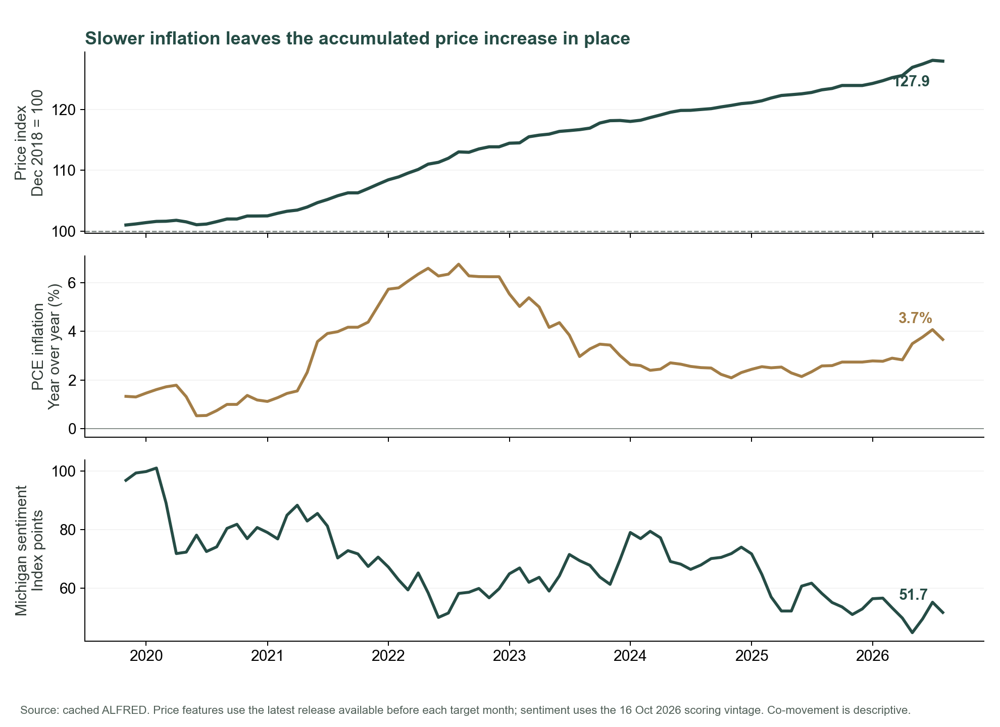
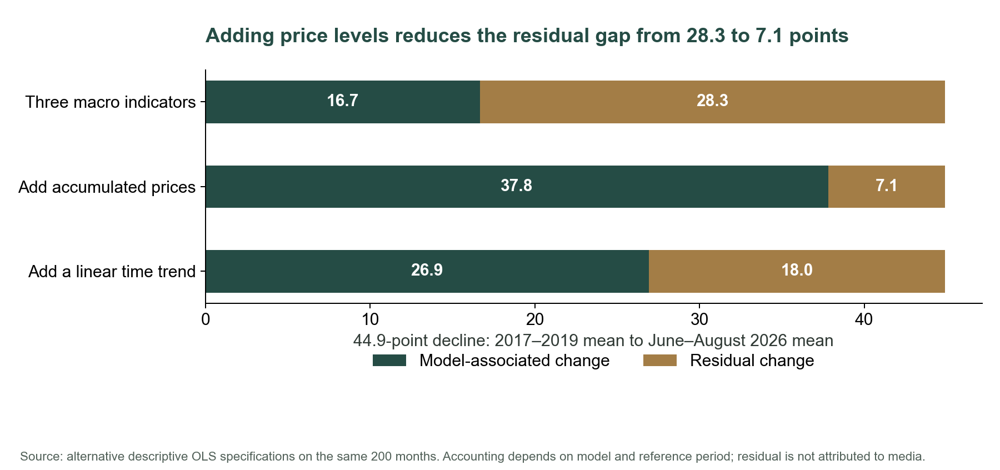
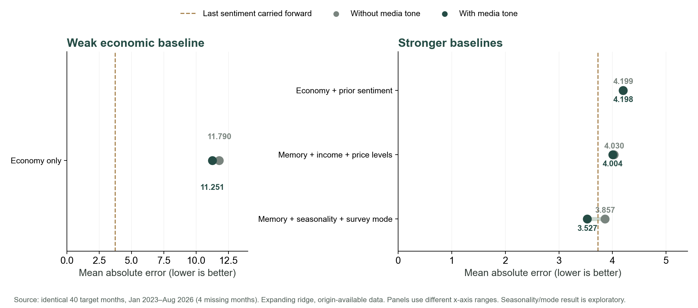
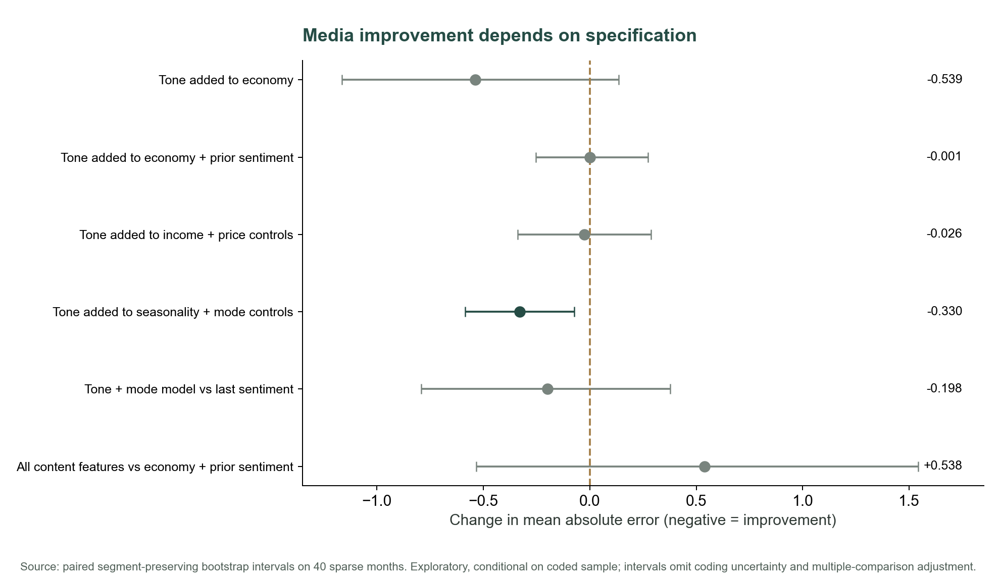
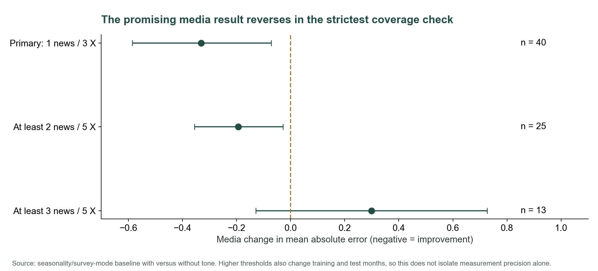

# 阶段 1–2：核心编码与研究结果

状态：两个阶段完成。版本为 `gpt_core_v3`。本文件是研究发现备忘录，正式报告、PPT 和演讲稿尚待后续阶段重写。旧版 Flash 结果保留作历史记录，不能与本版数字混用。

## 本轮完成了什么

- 主语料 1,473 条已全部由 Codex 对话中的 GPT 直接阅读并编码：复用原有 300 条，补完 1,173 条。脚本仅展开明确指定的分类并校验原文证据，不自动作语义分类。
- 每条保留九个内容维度、原文证据、简短理由及输入哈希；五项封存前规则纠正保留了修改前记录。全部评分已封存，新分析后没有修改标签。
- 前 300 条、随后 540 条、最后 633 条来自不同对话阶段；具体不可变模型版本未能完整记录，因此不能写成所有文本均由同一个确定版本完成。
- DeepSeek 仅用于原有 300 条抽样复核（新闻和 X 各 150 条），复用已缓存的 V4 结果。本轮没有新增收费 API 请求，也没有补充语料。
- 重建月度特征，比较 15 个固定预测规格，并保留所有结果；完成覆盖门槛、去重、地域筛选、正则强度、年份和价格水平/时间趋势检查。
- 生成 8 张 PNG/SVG 研究图。数据处理与预测相关的 44 项单元测试通过。

## 数据到底有多少

| 项目 | 新闻 | X |
|---|---:|---:|
| 编码候选文本 | 489 | 984 |
| 无实质经济内容 | 26 | 81 |
| 有经济内容，但明确为非美国主题 | 89 | 22 |
| 有经济内容，但美国主题无法从文本确认 | 144 | 52 |
| 纳入美国相关经济内容分析 | **230** | **829** |
| 每月可用条数中位数 | **2** | **10** |

媒体覆盖 2019 年 10 月至 2026 年 7 月，共 82 个月。9 个月没有可用新闻；73 个月满足至少 1 条新闻、3 条 X 的主门槛。预测评估为 2023 年 1 月至 2026 年 8 月的 **40 个共同月份**，该期间有 4 个月因媒体覆盖不足而缺失。

新闻只有标题，不是全文。美国相关主题包括美国参与的贸易和跨国比较，不能等同于美国受访者的实际信息接触。新闻缺少国家名也可能只是标题省略，不能把所有地域不确定文本当作外国新闻。这一筛选问题已单独做敏感性分析。

## RQ1：如何测量新闻或社交媒体中的偏差？

**最清楚的内容发现：平台间情绪化表达、政治归因的差异，大于负面经济情绪的差异。**

| 内容特征 | 新闻 230 条 | X 829 条 | X 比新闻高 |
|---|---:|---:|---:|
| 负面经济情绪 | 45.2% | 53.1% | 7.9 个百分点 |
| 情绪化或混合语言 | 23.9% | 86.1% | 62.2 个百分点 |
| 政治归咎或同时归功/归咎 | 22.6% | 49.6% | 27.0 个百分点 |

这些比例是本次样本的合并条数比例。预测模型中的新闻特征则先按媒体来源取均值，再让每个已观察来源等权，二者不要混写。

这个差异不只来自 X 有更多坏消息：在**正面**经济文本中，情绪化/混合语言占新闻 11.3%、X 77.5%；在负面文本中分别为 31.7%、92.3%。语言风格与经济好坏方向确实是两个不同维度。

由此可以提出清楚的测量框架：分别测量经济情绪、话题占比、价格/家庭框架、政治归因和数字可核验性。要进一步称为“报道偏差”，仍须比较相同事件/事实下的选题和表述；本样本的平台、体裁、主题不同，不能直接把上述百分点解释为因果平台效应。

数字核验方面，本版标签中没有向模型提供对应官方证据，因此 36 条新闻、210 条 X 的数字声明保留为“无法据所给材料核验”。历史文件 `reports/final_fact_checks.json` 另有特意选取的 4 个新闻标题、5 个数字声明与当时官方发布的对照；这不是随机真实性审查，不能推广成整个平台准确率。

## RQ2：这些内容是否压低了中期选举前的消费者信心？

**现有研究没有识别出媒体导致信心下降的指数点数；它发现的是预测关系对经济基准的依赖。**

纯经济模型平均把信心预测得过高。加入媒体情绪后，40 个月的平均绝对误差从 11.790 降至 11.251；但加入已经公布的消费者信心历史后，误差为 4.199，媒体进一步带来的变化接近零。说明媒体可能补充了弱经济模型遗漏的信息，但目前无法区分信息反映、消费者反应、共同冲击和媒体说服。

在最后一个可评估月份，2026 年 8 月实际信心为 51.7，纯经济预测 66.13，加媒体后 60.83；有信心历史的模型则为 56.18，加媒体后 54.50。这是一个能讲清楚模型差异的例子，不能单凭一个月证明媒体影响。

媒体截至 7 月，是为了用之前已出现的文本预测下一月 8 月信心。本项目并未覆盖 11 月选举前的最后数周，也没有把调查受访者与其实际阅读内容连接起来。

## RQ3：失业率、通胀和 GDP 能解释多少差距？

**更有价值的新发现是：所谓“未解释的信心差距”对经济基准非常敏感，累计价格水平能解释其中相当一部分统计差异。**

在 2010 年 1 月至 2026 年 8 月的 200 个月中，三项宏观指标的描述性 OLS 拟合 R² 为 0.502。2017–2019 年平均信心为 97.04，2026 年 6–8 月为 52.13，共下降 44.91 点。三指标模型关联的变化为 16.66 点，其中通胀项占 16.07 点，失业率 0.55 点，GDP 项约 0.03 点。

| 同样 200 个月的描述性基准 | R² | 44.91 点下降中剩余的模型差距 |
|---|---:|---:|
| 失业率、通胀、GDP | 0.502 | 28.25 点 |
| 再加入累计价格水平 | 0.768 | **7.08 点** |
| 改为加入简单线性时间趋势 | 0.632 | 17.99 点 |
| 再加入实际收入与累计价格 | 0.788 | 5.21 点 |

价格指标也通过了额外的预测检查：在完整宏观历史训练、2023 年至 2026 年 8 月的相同 44 个月上，三指标预测误差为 17.108，加入价格水平后为 8.712，加入简单时间趋势为 14.148。有信心历史的模型从 4.324 改善到加价格水平的 3.995；但上月信心直接延续仍为 3.618。它支持继续研究价格水平与购买力，不能证明已获得最佳模型。

这使“所有剩余差距都来自媒体”的说法更难成立。它也没有证明过去价格锚定：累计价格可能吸收真实负担、时代变化、趋势和其他遗漏因素。全样本拟合与上述参考期分解是描述性分析，不是消费者心理或因果贡献比例。

## RQ4：哪些感知机制可以测量？

**数据能测量内容线索，并能指出值得研究的机制；它不能直接测出受访者心理过程。**

| 候选机制 | 目前真正观察到的东西 | 研究结果与下一步 |
|---|---|---|
| Negativity bias | 负面经济情绪、情绪化语言 | X 的表达更情绪化；要识别心理效应，须比较同等信息量的好/坏消息引起的反应 |
| Availability bias | Topic salience，即所采文本的话题占比 | 价格主题占新闻 25.7%、X 37.6%；还需接触、记忆和调查回答的联系 |
| Confirmation bias | 政治归因内容 | 政治归咎/混合归因在 X 更普遍；缺少事前信念、选择性接触和信念更新 |
| Anchoring to past prices | 价格水平框架、累计价格指数 | 价格水平框架占新闻 8.3%、X 10.5%；宏观价格水平改善基准，但还需个人参考价格与实际收入/负担来区分锚定和真实压力 |

到 2026 年 8 月预测起点，最新可得 PCE 价格水平比 2018 年 12 月高 **27.9%**，同比通胀约 **3.7%**，实际可支配收入同比增长约 **0.5%**。这些数据使“通胀放缓，但生活仍贵”的解释有具体经济背景。三者是不同概念，不应互相替代。

## RQ5：媒体能否提高经济指标之外的预测能力？

**有一个值得继续研究的条件性信号，但稳定的普遍增益尚未建立。**

以下全部来自相同 40 个预测月份；误差越低越好。预测使用扩展训练窗口的标准化 ridge 回归，固定惩罚 1，只有 RQ3 的描述性分解使用 OLS。

| 基准 | 不加媒体情绪 | 加媒体情绪 | 配对误差变化的探索性区间 |
|---|---:|---:|---:|
| 三项经济指标 | 11.790 | 11.251 | −1.164 至 +0.136 |
| 经济指标 + 信心历史 | 4.199 | 4.198 | −0.252 至 +0.274 |
| 再控制收入与累计价格 | 4.030 | 4.004 | −0.338 至 +0.286 |
| 信心历史基准 + 季节项和调查方式过渡项 | 3.857 | **3.527** | **−0.585 至 −0.072** |
| 上月已公布信心直接延续 | **3.725** | — | — |

最后一组中的媒体增益为 0.330 点，约 8.6%，不能因它是正面结果而遗漏。它在去 URL 重复、地域扩展、惩罚 0.1/10、每月至少 2 新闻/5 X 的检查中仍为改善；但提高到至少 3 新闻/5 X 后，只有 13 个测试月，媒体由改善变成恶化 0.299 点。门槛同时改变训练和测试样本，因此不能单独归因于文本测量精度。

该模型相比简单延续上月信心的平均误差改善只有 0.198 点，配对区间为 −0.791 至 +0.377，仍跨过零。季节/调查方式项也可能代理其他时间变化。初次发现这个增益后才追加的稳健性检查记录在 `ANALYSIS_EXTENSION_LOG.md`，不能称为独立验证。

六类内容份额单独加入信心历史基准后，都没有得到排除零的改善区间；把情绪、政治归因、话题等所有特征一次放入，误差升至 **4.737**。增加特征数量本身没有解决小样本预测问题。

## RQ6：什么证据会反驳媒体偏差解释？

本轮已经找到两类挑战强媒体解释的证据：

1. **经济基准遗漏问题。** 加入累计价格显著缩小统计差距；不能把原本 28.25 点残差直接分配给媒体。
2. **增量预测不稳定。** 信心历史加入后，基础媒体增益几乎为零；季节/方式控制下的正面结果，在最严格覆盖检查中消失，也没有明确胜过简单信心延续。

这些结果削弱“媒体有巨大且稳健的独立解释力”的说法。它们不等于否定一切媒体影响，因为稀疏内容样本也可能测不到真实接触。

进一步研究应针对可被反驳的具体说法：如果同一经济事件的事实/严重程度控制后，媒体差异消失，就削弱“歪曲事实”的版本；如果更好的家庭收入、必要支出和参考价格解释了差距，就削弱“心理偏差是主因”的版本；如果真正的媒体接触变化并未先于个人信心变化，或相同事实的不同框架没有引起差异，就削弱说服机制。当前没有开展这些新研究，不能把它们写成发现。

## 结果可信度应该如何表述

300 条原有复核样本中，DeepSeek 有 293 条有效输出；新闻 148 对、X 145 对。总体情绪一致率为 **65.2%**，κ = **0.539**；原有 200 条留出身份中的有效配对 196 条，一致率 **63.8%**，κ = **0.522**。政治归因一致率 89.1%，价格框架 86.7%，语言风格 61.8%，话题集合完全一致率 54.6%。

这意味着细致的语言风格、情绪和主题判断仍有不小的测量分歧。上述复核复用了原有结果，不是本轮新完成的独立复制，也没有人工真值。预测 bootstrap 区间不包含标签不确定性或多规格比较校正。结果应作为探索性研究发现呈现。

分编码批次检查后，X 的情绪化/混合语言比例约 84%–87%，新闻约 13%–41%，每个批次内的平台差异方向一致，但幅度不一致。原有 300 条是抽样复核队列，另外两批的日期范围也不同，不能把批次差异解释为时间趋势或模型效应。具体构成保存在 `session_composition.json`。这为“方向存在”提供了一项内部检查，同时提醒我们不要过度解读精确百分点。

## 可用于下一阶段的实质性结论

- 平台差异主要体现在情绪化表达与政治归因；仅用平均情绪会丢失这些维度。
- 消费者信心差距的一部分来自经济基准选择；持续的价格水平压力是重要候选解释。
- 媒体预测信号依赖控制项和覆盖规则。一个有希望的结果值得继续检查，但不足以宣布普遍稳定的媒体增益。
- 数据能描述内容，却还不能把内容差异转换成消费者心理偏差或选举前媒体压低信心的因果点数。

正式 presentation 可围绕这些发现分享证据、解释研究中遇到的问题，再用具体后续设计说明如何解决。模型和敏感性细节留在正式报告或附录。
