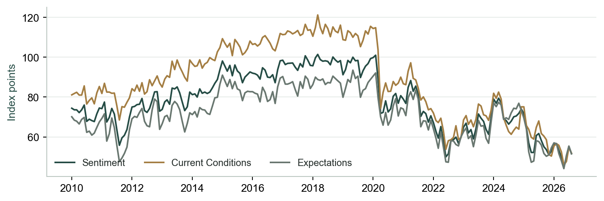
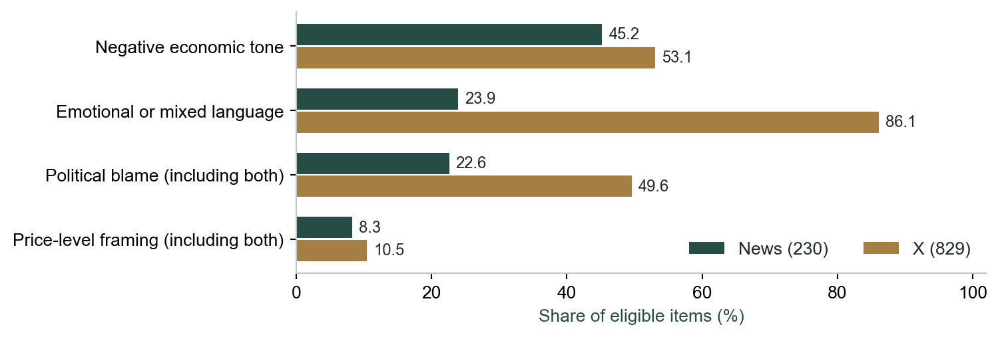
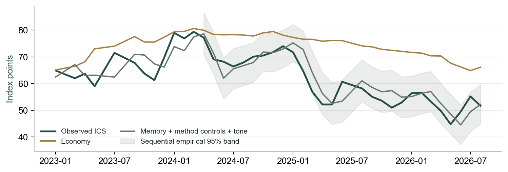
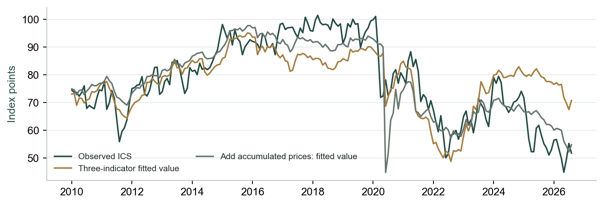
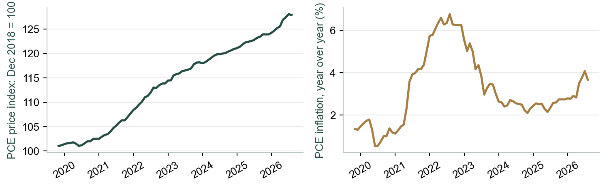
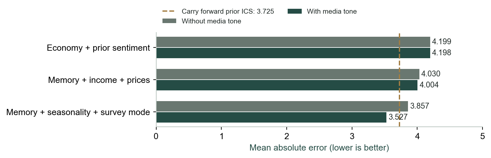
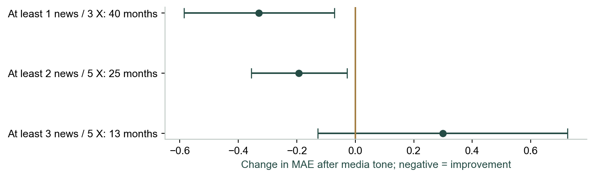
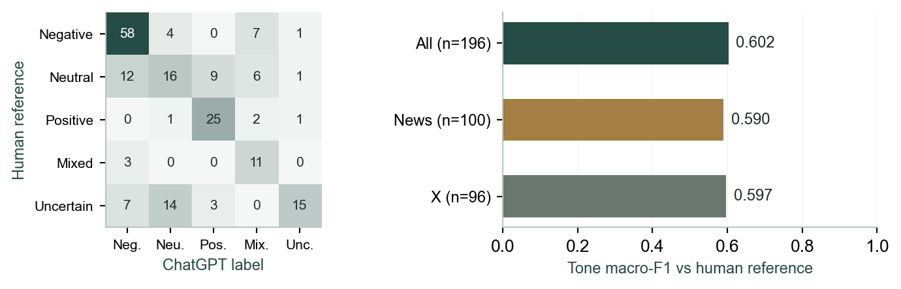

# Consumer sentiment, prices and media

Victor Chen

FRE-GY 7871

Instructor: Dr. Daniel Rodriguez

GitHub: [github.com/victor4628/ai-media-consumer-sentiment](https://github.com/victor4628/ai-media-consumer-sentiment)

## 1. Consumer sentiment, prices and media

Six research questions | Research cutoff: 16 October 2026

Main finding. The apparent gap between economic conditions and consumer sentiment changes substantially when the economic benchmark includes accumulated prices and recent sentiment. Media tone contains a promising predictive signal in one controlled specification, but its benefit reverses in the smallest, most strictly covered sample.

RQ1 — How can we measure bias in coverage? Separate economic tone from emotional language, political attribution, topic salience and price framing. In the eligible sample, emotional or mixed language appears in 86.1% of X posts versus 23.9% of news headlines. This is a content contrast, not a population estimate of platform bias.

RQ2 — Does bias depress sentiment before the midterms? Our last observation is August 2026, before the final campaign weeks. The economy-only model predicts 66.1 against observed ICS of 51.7; adding media tone predicts 60.8. That smaller forecast gap does not identify a causal media effect.

RQ3 — What do unemployment, inflation and GDP explain? Relative to 2017–2019, the June–August 2026 mean ICS falls 44.9 points. Three indicators account descriptively for 16.7 points. The residual falls from 28.3 to 7.1 points when accumulated prices enter the same descriptive analysis.

RQ4 — Which perceptual mechanisms can we measure? We observe content proxies for negativity bias, availability bias, confirmation bias and anchoring to past prices. We do not observe individual exposure, recall, prior beliefs or personal reference prices.

RQ5 — Does media improve prediction? Almost no improvement follows a baseline with prior sentiment: MAE 4.199 to 4.198. Adding seasonality and survey-mode controls produces 3.857 to 3.527, compared with 3.725 for simply carrying forward prior sentiment.

RQ6 — What contradicts a media-bias explanation? A stronger price benchmark shrinks the residual; the media benefit reverses under the strictest coverage rule; extra content features together worsen prediction. These are substantive challenges to a strong media-only account.

Study base. 1,473 candidate items were coded directly by GPT; 230 US-relevant economic news headlines and 829 X posts qualify for the primary analysis. Media cover October 2019–July 2026. The matched forecast comparison contains 40 months from January 2023–August 2026. No new data were purchased for this revision.

## 2. How Michigan consumer sentiment is calculated

Five survey questions combine views of personal finances and the wider economy.

The University of Michigan Index of Consumer Sentiment (ICS) uses five questions: personal finances compared with a year ago; expected personal finances a year ahead; expected business conditions over the next year; expected business conditions over the next five years; and whether now is a good time to buy major household goods. Favorable and unfavorable response categories are defined separately for each question. [1]

Relative score: x_i = round(100 + percentage favorable_i − percentage unfavorable_i). Index: ICS = (x_1 + x_2 + x_3 + x_4 + x_5) / 6.7558 + 2. Round each relative score first; the denominator and constant place the combined scores on the historical index scale. This is not the percentage of respondents who feel optimistic. [1]

Current Economic Conditions combines the first and fifth questions; Consumer Expectations combines the second, third and fourth. Two current-condition questions and three expectation questions therefore enter the overall index. The plotted components help distinguish a weak present assessment from weak expectations, without attributing either to a specific media source.

Sampling and survey mode also matter. Michigan phased from telephone to web interviews between April and July 2024. Our forecasting sensitivity includes a fixed ramp of 0.25, 0.50, 0.75 and 1.00 over those months plus seasonal sine/cosine terms. This is a coarse control, not proof that method changes explain the sentiment decline. [2,3]

## 3. RQ1 | What do our measures show?

The strongest platform contrast is emotional language, rather than negative tone alone.

| Release benchmark | Sources | Existing tone / style labels |
| --- | --- | --- |
| Q2 2021 GDP: +6.5% | ABC / Reuters | positive / factual; positive / factual |
| May 2023 jobs: +339,000 | ABC / Bloomberg | positive / factual; mixed / factual |
| Mar. 2024 PCE: 2.7% YoY | Bloomberg / CNN | negative / factual; negative / mixed |

GPT assigned categorical judgments for economic relevance and US scope, economic tone, language style, topics, household/national framing, price levels versus price changes, current/future focus, and political blame or credit. Negative economic news can be expressed factually; a positive economic claim can still use emotional or partisan language. We measure these separately.

The corpus contains 489 candidate news headlines and 984 X posts. The primary inclusion rule requires economic substance, clear US relevance and availability before the next monthly forecast origin. It retains 230 news headlines and 829 X posts. News excludes 26 non-economic, 89 foreign and 144 uncertain-US items; X excludes 81, 22 and 52 respectively. Uncertain scope is excluded rather than silently treated as US.

Negative tone differs by 7.9 percentage points, while emotional or mixed language differs by 62.2 points. Political blame, including both blame and credit, differs by 26.9 points. Within positive-tone items, emotional or mixed language is still 77.5% for X versus 11.3% for news. The rhetorical contrast is not simply a consequence of X containing more negative items.

A new purposive audit matches six straight-news headlines to three official releases, using release date, observation period and source URLs. The table retains the original GPT labels; one same-day commentary is recorded separately. The jobs release combines payroll growth with rising unemployment [4], and the PCE release has distinct headline/core measures [5]. Matching a release therefore does not hold every factual facet constant. These cases illustrate framing differences and agreements, not a population bias rate or a causal source effect. Five earlier numerical checks in four headlines remain illustrative, not a general accuracy estimate.

## 4. RQ2 | Is media depressing sentiment?

A lower forecast gap is evidence of association; the causal quantity is not identified.

We compare actual sentiment with forecasts based on information released before each target month. In August 2026, observed ICS is 51.7, the three-indicator forecast is 66.13, and the same model with prior-month news and X tone gives 60.83. Carrying forward the most recently available ICS gives 55.2. The economy-only benchmark therefore leaves a much larger gap than a simple memory benchmark.

It would be incorrect to call the 5.30-point difference between the two model predictions a measured depressive effect of media. Media may report the same price pressure consumers experience; economic disappointment may generate negative posts; the retrieval process may change alongside elections. None of these possibilities is separated by aggregate monthly prediction.

The shaded band is constructed sequentially from the 95th percentile of earlier absolute out-of-sample errors, using only errors whose target values were released by the current origin. It starts after at least 12 calibration errors. It is an empirical prediction band, not a causal confidence interval or a guarantee of 95% coverage under dependence.

For memory plus method controls plus tone, 28 months have bands; empirical coverage is 96.4%, with mean width 15.05 points. These small-sample diagnostics should accompany point forecasts. The media archive ends in July 2026 and predicts through August. We have no evidence here about the final election weeks or election outcomes.

## 5. RQ3 | How much do three indicators explain?

Unemployment, annual inflation and real GDP growth leave a large descriptive residual.

The accounting exercise is ordinary least squares with an intercept, fitted to 200 monthly observations from January 2010 to August 2026. Regressors are unemployment, PCE inflation over the prior year and the latest released annualized quarterly real GDP growth rate. The target is the cutoff-vintage ICS. Origin-available macro releases are used, but fitting the entire window makes this a descriptive exercise rather than an out-of-sample forecast.

The mean ICS falls from 97.04 in 2017–2019 to 52.13 in June–August 2026, a 44.91-point decline. The fitted three-indicator association accounts for 16.66 points: inflation 16.07, unemployment 0.55 and GDP growth 0.03. A 28.25-point residual remains. The in-sample R-squared is 0.502. These components are regression accounting, not independently estimated causal contributions.

Adding accumulated price growth reduces the residual to 7.08 points and raises R-squared to 0.768. Adding a linear time trend instead leaves 17.99 points; adding both real income growth and accumulated prices leaves 5.21. Accumulated prices therefore contain information beyond a simple linear trend in this window, while also potentially absorbing other persistent changes.

Reference choice matters. Using 2015–2019 instead of 2017–2019 changes the three-indicator accounting share from 37.1% to 43.3%. Those shares belong in methodological interpretation, not as headline causal percentages. Residual movement must not be assigned automatically to media, political bias or consumer irrationality.

## 6. RQ3 | Slower inflation is not lower prices

The accumulated shopping bill remains an important competing explanation.

The last pre-August 2026 information set shows PCE prices 27.94% above December 2018, annual PCE inflation of 3.67%, and annual real disposable income growth of 0.52%. The first quantity is a cumulative increase; the second is the current pace of increase. A slower pace does not undo earlier increases. These are the latest available releases at that forecast origin, not claims that all three describe August itself.

This supports examining purchasing power directly. It does not show that consumers irrationally anchor to an old price: high current prices may create a real budget constraint, while changing incomes, wealth, debt, housing costs and expectations can also matter. Different households face different spending baskets, which aggregate PCE cannot identify.

A separate forecast check uses the full macro training history, with 44 common test months. Adding accumulated prices to the economy-only model reduces MAE from 17.108 to 8.712; adding a linear trend reduces it only to 14.148. The nominal block-bootstrap interval for the price improvement is −11.04 to −5.75 points of MAE. This supports price relevance beyond the full-sample fit.

A stronger memory benchmark changes the comparison: adding prices reduces MAE from 4.324 to 3.995, but carrying forward prior sentiment gives 3.618. The price model does not establish a reliable improvement over persistence; its relative interval is −0.29 to +1.02. This 44-month experiment uses a different training sample from the 40-month media experiment. Their absolute errors must not be compared as if generated by identical histories.

## 7. RQ4 | Which mechanisms can we measure?

The archive measures content proxies; consumer mechanisms require individual responses.

Negativity bias — negative economic tone. We can measure how often negative content appears: 45.2% of news and 53.1% of X. Negativity bias itself means people respond more strongly to negative than equivalent positive information. That requires matched facts, exposure and a measured response; content frequency alone does not measure that asymmetry.

Availability bias — topic salience. Prices appear in 25.7% of news and 37.6% of X, with multilabel topics permitted. This measures prominence within our selection. Availability bias requires showing that exposure changes recall or perceived frequency beyond actual conditions. We have no individual exposure or recall observations.

Confirmation bias — political blame. Political blame, including both blame and credit, occurs in 22.6% of news and 49.6% of X. That measures attribution in the message. Confirmation bias requires pre-existing beliefs, source preferences and belief updating after congruent versus incongruent evidence. Party-linked aggregate differences would not by themselves identify individual updating.

Anchoring to past prices — price-level framing. Explicit price-level framing occurs in 8.3% of news and 10.5% of X. Accumulated PCE growth is a separate macro proxy. Neither reveals a respondent’s reference price or whether it persists after income and current purchasing power are held fixed.

What the data can support. We can describe framing, compare coded content, and assess incremental monthly prediction. We cannot estimate these four psychological mechanisms as consumer-level parameters. No respondent microdata or linked media-consumption records are included; no individual age, income, education, party or regional mechanism analysis has been performed.

Next measurement step. Collect reference prices and current budgets alongside media exposure, prior beliefs, recall and subsequent sentiment. Link these measurements within respondents. That design can distinguish rational household pressure from anchoring, and media selection from belief change. No such follow-up has been run in this project.

## 8. RQ5 | Does media add predictive information?

The result depends on whether the benchmark includes memory and survey controls.

All comparisons on this page use the same 40 eligible out-of-sample months. Forecasts use expanding-window ridge regression with fixed penalty 1, an intercept, and means/scales estimated only within each training window. At least 24 eligible training months are required. Target values are drawn from releases available at each forecast origin. Media features refer to the preceding month; no future labels or later target revisions enter training.

The weak economy-only model improves from MAE 11.790 to 11.251 after tone, but this does not establish useful forecasting. With prior sentiment already included, the improvement is effectively zero: 4.199 to 4.198. Adding income and accumulated prices produces 4.030 to 4.004. Their nominal 95% paired intervals for media’s MAE change include zero: respectively [−0.252, +0.274] and [−0.338, +0.286].

After seasonality and survey-mode controls, adding tone reduces MAE from 3.857 to 3.527: a change of −0.330 with nominal interval [−0.585, −0.072]. The new null-centered block-bootstrap comparison gives raw p = 0.0105 and Holm-adjusted p = 0.147 across all 14 original recorded comparisons. This exploratory gain does not survive that family adjustment. Its advantage over persistence is −0.198 [−0.791, +0.377], which also fails to establish a reliable win over the simple baseline.

Adding all tone and framing features together worsens MAE to 4.737. The six individual content additions produce MAEs 4.124 (price levels), 4.246 (political blame), 4.080 (emotional language), 4.132 (household scope), 4.498 (price topic) and 4.107 (employment topic). All 15 fixed model specifications remain in the machine-readable results; the report does not select a winner and discard alternatives.

## 9. RQ6 | What challenges the media account?

Coverage, lag choice and multiple comparisons limit the forecasting claim.

| Separate 30-month experiment | MAE | Change vs controls |
| --- | --- | --- |
| Controls baseline | 3.894 | — |
| Add tone: prior month | 3.452 | -0.443 |
| Add tone: two months prior | 3.783 | -0.111 |
| Add tone: three months prior | 3.673 | -0.222 |
| Carry forward prior sentiment | 3.720 | -0.174 |

The original coverage check gives media MAE changes of −0.330 (40 months), −0.193 (25) and +0.299 (13) as minimum counts rise from 1 news/3 X to 2/5 and 3/5. The strictest estimate reverses. Filtering changes both training and evaluation months; it does not identify an effect of article count.

The new lag experiment uses identical histories and 30 test months for all three lags, after requiring coverage at each calendar lag. Its 54 eligible rows support at least 24 expanding training observations. Two- and three-month lag increments have nominal intervals spanning zero. This sample differs from the original 40-month experiment; their MAE levels must not be compared as if histories were identical.

In the original controls-plus-tone model, standardized news coefficients remain positive (0.477 to 0.997); X coefficients range from −0.641 to 0.964 and change sign three times between observed origins. These are conditional associations on a changing training scale, not causal effects or a formal structural-break test.

Forecast errors have calendar-adjacent lag-one correlation 0.449 across 35 pairs. One-, three- and six-month block checks retain the nominal controls-model gain, but all comparisons with persistence span zero. The new lag tests and block checks are retrospective and exploratory; the 14-comparison Holm family on page 8 covers the original comparisons, not every possible extension.

## 10. Data, coding and human-reference validation

Class-level scores reveal weaknesses hidden by overall agreement.

| Human-reference tone | Human n | Precision | Recall | F1 |
| --- | --- | --- | --- | --- |
| Negative | 70 | 0.725 | 0.829 | 0.773 |
| Neutral | 44 | 0.457 | 0.364 | 0.405 |
| Positive | 29 | 0.676 | 0.862 | 0.758 |
| Mixed | 14 | 0.423 | 0.786 | 0.550 |
| Uncertain | 39 | 0.833 | 0.385 | 0.526 |

One human annotator independently labeled a 300-item reference sample: 150 news headlines and 150 X posts. There are 293 valid human–ChatGPT pairs and seven unavailable reference labels. Full-sample tone agreement is 65.2%, kappa 0.539. The original held-out subset has 196 pairs, 63.8% agreement and kappa 0.522. Source attribution follows the project owner’s correction, retained in the provenance protocol.

Held-out five-class tone macro-F1 is 0.602. Neutral F1 is 0.405 and uncertain recall is 0.385. Undefined class rates remain missing; absent classes are not assigned perfect scores. All categorical dimensions, multilabel topics, platform groups and source groups are supplied in the analytical package. Source groups below ten pairs are flagged as small; the X source denotes a retrieval endpoint, not individual authors.

On the same 112 eligible held-out items, three-class macro-F1 is 0.777 for GPT and 0.199 for the simple dictionary. Both coders’ mixed labels map to neutral; uncertain labels and unavailable dictionary rows are excluded explicitly. This subset is not the 196-item five-class test. A single human reference is not consensus truth.

The 1,473 primary GPT judgments span multiple sessions; exact immutable model versions were not retained. Private-input evidence/schema checks and visible, constructed source/name swaps test traceability and example consistency. They do not establish population accuracy. Original labels and predictions remain frozen; no new adjudication or model inference was performed.

## 11. What would make the conclusion stronger?

Separate household pressure, selective exposure and changes caused by framing.

Identifying media framing. A proposed study would randomize presentation of identical verified economic facts. A 2 × 2 design could vary negative versus neutral wording and price-level versus inflation-rate emphasis while holding the factual numbers fixed. Randomize source labels separately or balance them across cells. Record pre-exposure sentiment, party beliefs, reference prices and budgets; then measure immediate belief change, recall and delayed sentiment.

Specify the primary contrast, exclusions, smallest meaningful effect and analysis before collecting outcomes. For illustration, detecting a standardized difference of 0.25 with 80% power in one two-group contrast at a two-sided 5% level needs roughly 502 participants in total before attrition, using the normal approximation. A four-cell design needs a separate power calculation, especially for interactions and multiple outcomes. This is a proposed follow-up; no experiment or participant recruitment occurred.

A framing effect in a convenience experiment would not directly quantify the national Michigan ICS effect. That translation needs representative exposure shares, treatment intensity, persistence and population weights. A narrow near-zero effect, stable across informative exposure manipulations, would contradict the proposed framing channel; a noisy null would not settle it.

Prospective forecast plan. Freeze this codebook, primary model, controls, coverage rule and persistence comparison before the next evaluation. At each monthly origin, archive official release vintages, preserve retrieval timestamps and record missingness. Code new content without looking at the next sentiment release, retain human–ChatGPT disagreements for audit, and evaluate only after the target is released. Do not change the story solely because one month looks favorable.

Financial research implication. Forecasts used for consumer demand or portfolio risk scenarios should start with recent sentiment and purchasing-power measures. Add text only when it improves an honestly matched future evaluation. A forecast-gap alert should show the economic benchmark, empirical interval and sample coverage together; a large residual alone is not evidence of a media-driven deterioration in consumer demand.

Monitoring implementation. The offline dashboard now displays the economic-model gap, coding-status counts, a separate purposive factual audit, curated release/method events, class-level validation and lag/coefficient diagnostics. A release-vintage table distinguishes observation periods from forecast cutoffs. The update guide separates rebuilding this frozen snapshot from collecting and evaluating a new prospective study. Media still end in July 2026; no final-election-week evidence is added.

## 12. Sources, reproducibility and scope

A public arithmetic reproduction is supplied; private-text extraction and inference are not rerun.

Official measurement sources. [1] University of Michigan, “Index Calculations,” https://data.sca.isr.umich.edu/fetchdoc.php?docid=75432. [2] University of Michigan, 2024 survey-method transition announcement, https://www.sca.isr.umich.edu/files/methodtransitionannouncement2024.pdf. [3] Surveys of Consumers FAQ, https://data.sca.isr.umich.edu/faq.php. These sources define construction and mode changes; they do not support a causal media claim. [4] BLS, May 2023 Employment Situation, https://www.bls.gov/news.release/archives/empsit_06022023.htm. [5] BEA, March 2024 Personal Income and Outlays, https://www.bea.gov/news/2024/personal-income-and-outlays-march-2024. [6] BEA, Q2 2021 GDP advance estimate, https://www.bea.gov/news/2021/gross-domestic-product-second-quarter-2021-advance-estimate-and-annual-update.

Macroeconomic releases. ALFRED/FRED series: UMCSENT (Michigan ICS), UNRATE (BLS unemployment), PCEPI (BEA PCE price index), GDPC1 (BEA real GDP) and DSPIC96 (BEA real disposable personal income). The archive contains 1,005 source snapshots, five series at 201 vintages. Snapshot hashes and release periods are included. Example source: https://alfred.stlouisfed.org/series?seid=UMCSENT. Component series are supplied separately for descriptive plotting.

Content and numerical checks. Existing historical news retrieval and TwitterAPI.io queries supply the convenience archive; no new content is collected in this revision. The frozen core configuration records query windows. reports/final_fact_checks.json lists the five purposive numerical checks, contemporaneous official URLs, and their limited scope. Source documents and presentation source notes must be read with the research cutoff, not interpreted as election forecasts. The new event manifest records primary official URLs, curated membership and paraphrased headline emphases; matching is retrospective and not blind.

Reproduce the statistics. Run python scripts/reproduce_submission.py from the extracted package. It checks included file hashes, original-input identifiers, release snapshots, monthly aggregation, origin-time macro transformations, all fixed forecast specifications and robustness comparisons against frozen results. Run python -m unittest discover -s tests for the test suite. No network calls or API credentials are required. Dependencies are in requirements.txt. The same command verifies the four additions; python scripts/run_rubric_extension.py --verify runs that check alone. Supplemental tables and methods are in reports/rubric_extension/RESULTS.md and the update guide.

Reproduction boundary. Public exports contain item metadata and categorical labels, not private full text, quotations or rationales. The original annotation seal covers the richer private payload; the export has its own file hash. Original full-input hashes can be compared between label and metadata records, but cannot be recomputed without the private inputs. The single deduplication exclusion is replayed from a frozen ID; duplicate extraction and semantic judgments cannot be independently rerun from this export.

Reading the evidence. Descriptive fits use 200 months; macro-only forecasts use 44 test months; the primary media comparison uses 40. The common-lag extension uses 30 different matched test months. Original nominal intervals remain unchanged; approximate Holm-adjusted bootstrap p-values additionally cover 14 original paired comparisons. New lag and robustness checks remain exploratory. No consumer-level mechanism, causal media effect, consensus-label accuracy, final-election-week effect or investment-return backtest is established.

Delivery. Twelve-page report; ten-slide presentation; aligned English speaker script; offline dashboard; frozen analysis and source snapshots; and a package verification log. The final slide summarizes findings. The technical material here supports the presentation without requiring it to become a modeling lecture.

